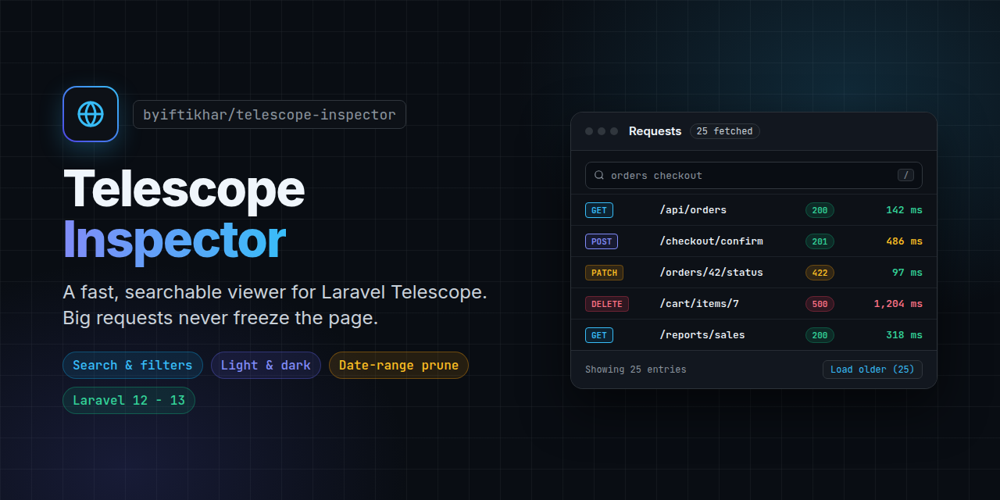
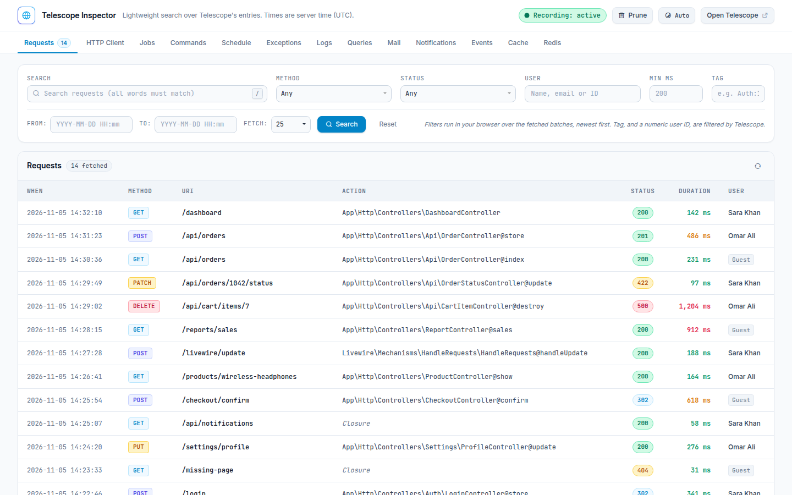
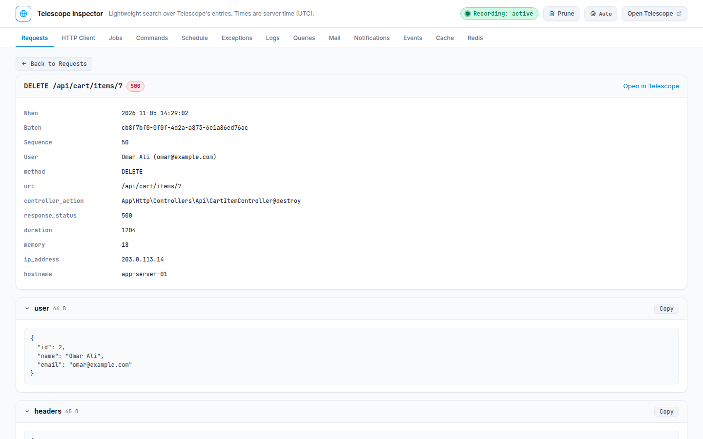

<p align="center">
    
</p>

<p align="center">
    <a href="https://packagist.org/packages/byiftikhar/telescope-inspector"></a>
    <a href="https://packagist.org/packages/byiftikhar/telescope-inspector"></a>
    <a href="https://github.com/byiftikhar/telescope-inspector/actions/workflows/tests.yml"></a>
    
    
    
    <a href="LICENSE"></a>
</p>

<p align="center"><strong>Search, filter and prune Laravel Telescope entries without the page freezing on big requests.</strong></p>

> A fast, searchable viewer for Laravel Telescope, the debug assistant for the Laravel framework.

## What is Telescope Inspector?

[Laravel Telescope](https://laravel.com/docs/telescope) records every request, query, job, exception and
log in your Laravel app. Its own screen, however, loads 50 entries at a time **with their full content**
(request payload, headers, session, response). One heavy request on a page can make that page several MB,
and the Telescope requests page stops loading. It also cannot search by route, status, job or user.

Telescope Inspector adds one page, `/telescope-inspector`, that reads **Telescope's own API** in small
batches, keeps only a short summary of each entry, and lets you search and filter everything Telescope
records. It adds no tables, migrations or jobs, and changes nothing in how Telescope records.

<picture>
    <source media="(prefers-color-scheme: dark)" srcset=".github/assets/screenshot-dark.png">
    
</picture>

## Features

- **Every Telescope type**: Requests, HTTP Client, Jobs, Commands, Schedule, Exceptions, Logs, Queries,
  Mail, Notifications, Events, Cache and Redis.
- **Never freezes**: fetches 10, 25 or 50 entries at a time; big entries are never drawn in the list.
- **Search and filters**: all-words search (route, controller, job class, SQL, message), plus method,
  status (2xx to 5xx), user (name, email or id), job status, log level, minimum duration, date range and
  Telescope tag. Scans older entries until 50 matches are found, with a Stop button.
- **Request detail**: overview, collapsible sections (anything over 20 KB starts closed, over 50 KB shows
  "Show all"), copy buttons, and everything recorded in the same request: queries with total time, slow
  count and repeated statements (possible N+1), logs, exceptions, jobs and HTTP calls. For a job it also
  shows what ran inside the worker.
- **Prune by date**: delete entries in a date range, optionally only some types and keeping exceptions.
  Quick ranges (older than 1 hour, 6 hours, 1 day, 7 days, or all entries), a live count and a
  confirmation before anything is removed.
- **Light and dark theme**: Auto (follows the operating system), Light or Dark, remembered per browser.
- **Clean, shareable URLs**: `/telescope-inspector/requests/<uuid>/<batch>`; refresh, Back/Forward and
  Ctrl-click work as usual. Press `/` to jump to the search box.
- **Stays out of the way**: its own page and endpoints are added to `telescope.ignore_paths`
  automatically, so using the inspector never fills Telescope with entries about the inspector.

<picture>
    <source media="(prefers-color-scheme: dark)" srcset=".github/assets/detail-dark.png">
    
</picture>

## Requirements

- PHP 8.2+
- Laravel 12 or 13 (Laravel 11 may work, but Composer now blocks its releases over security advisories, so it is not tested)
- [`laravel/telescope`](https://github.com/laravel/telescope) 5.x, installed and enabled

## Installation

Install it the same way Telescope is installed in your project:

```bash
# Telescope is a dev dependency (local only):
composer require byiftikhar/telescope-inspector --dev

# Telescope also runs on staging / production:
composer require byiftikhar/telescope-inspector
```

The service provider is discovered automatically. Open `https://your-app.test/telescope-inspector`.

## Updating

```bash
composer update byiftikhar/telescope-inspector
```

## Access

The page uses **the same middleware as Telescope** (`config('telescope.middleware')`), so whoever can
open `/telescope` can open the inspector, and nobody else. Outside the `local` environment that is
decided by the `viewTelescope` gate in `app/Providers/TelescopeServiceProvider.php`. Make sure that gate
does not simply `return true`, or every signed-in user can read every recorded request.

## Pruning

The Prune button calls two endpoints the package adds next to the page (with the same middleware):
`POST {path}/prune/preview` (how many entries match) and `POST {path}/prune` (delete them). It deletes
from Telescope's `telescope_entries` table in chunks, the same way `php artisan telescope:prune` does,
and the entries' tags go with them. Every prune is written to the application log
("Telescope Inspector: entries pruned", with the user id, range, types and count).

- Needs Telescope's `database` storage driver.
- "To" is a whole minute and is included: `To 10:30` removes everything up to 10:30:59.
- To let only some people prune, define a `pruneTelescope` gate, for example in
  `app/Providers/TelescopeServiceProvider.php`:

  ```php
  Gate::define('pruneTelescope', fn ($user) => in_array($user->email, ['admin@example.com']));
  ```

  When that gate exists the user must pass it as well as the Telescope gate. Without it, anyone who can
  open Telescope can prune (Telescope's own screen can already clear everything).
- To remove the feature entirely, set `TELESCOPE_INSPECTOR_PRUNE=false`.

## Configuration

Optional. Publish the config file only if you need to change something:

```bash
php artisan vendor:publish --tag=telescope-inspector-config
```

| Key | Env | Default | Meaning |
| --- | --- | --- | --- |
| `enabled` | `TELESCOPE_INSPECTOR_ENABLED` | `true` | Register the page at all. |
| `path` | `TELESCOPE_INSPECTOR_PATH` | `telescope-inspector` | URL of the page. |
| `middleware` | | `null` | `null` reuses Telescope's middleware; or give your own array. |
| `default_take` | | `25` | Entries fetched per request (10, 25 or 50). |
| `match_target` | | `50` | Matches collected per Search / "Keep searching" click. |
| `prune.enabled` | `TELESCOPE_INSPECTOR_PRUNE` | `true` | Show the Prune button and register its endpoints. |
| `prune.chunk_size` | | `1000` | Rows deleted per statement while pruning. |

Telescope's own `path` and `domain` settings are picked up automatically.

## How it stays fast, and its limits

- Lists call `POST {telescope}/telescope-api/{type}` with a small `take` and a `before` cursor.
- Telescope's detail endpoint also returns **every** entry of the batch with no limit (thousands of
  queries for a heavy request), so the page asks the list endpoint filtered by `batch_id` instead and
  loads related entries 25 at a time.
- Telescope's API can only filter by **tag** on the server. A numeric user id is sent as Telescope's
  `Auth:<id>` tag; every other filter runs in the browser over the fetched batches, newest first. A
  search for something rare may page through many entries before it finds a match.
- An entry is still downloaded in full when it is part of a fetched batch; it is just never rendered.
- Times are the server's time, as Telescope stores them.

## FAQ

**Why does the Laravel Telescope requests page not load, or load very slowly?**
Telescope's list endpoint returns the full content of 50 entries at once. A few requests with large
payloads or responses make that response several MB. Telescope Inspector asks for 10 to 50 entries at a
time and only keeps a summary of each, so the list stays fast.

**How do I search Laravel Telescope entries by URL, route or controller?**
Type any part of the URI or controller in the Search box. All words must match, so `orders store` finds
`POST /api/orders` handled by `OrderController@store`.

**How do I filter Telescope requests by user, status code or duration?**
Use the User (name, email or numeric id), Status (2xx to 5xx) and Min ms filters on the Requests tab.

**How do I find slow queries or N+1 queries for one request?**
Open the request. The Queries tab underneath shows total query time, slow queries and repeated
statements.

**How do I prune Laravel Telescope entries by date?**
Click Prune, pick a quick range or a From/To date, optionally choose entry types, check the count and
confirm. Pruning by schedule is still best done with `php artisan telescope:prune`.

**Does it replace Laravel Telescope?**
No. Telescope keeps recording exactly as before; this is a faster, searchable screen on top of its data.
The "Open in Telescope" link is always one click away.

## Front-end assets

Bootstrap 5.3.3, Remix Icon 4.5.0, bootstrap-select 1.14.0-beta3, flatpickr 4.6.13 (plus its dark theme),
SweetAlert2 11.22.5 and jQuery 3.7.1 (plus the Inter and JetBrains Mono fonts from Google Fonts) are
loaded from jsDelivr / code.jquery.com with exact versions and SRI hashes. Nothing needs to be
published or built. The viewer's browser needs internet access.

All recorded data is rendered as text (`textContent`), never as HTML.

## Development

```bash
composer install
composer test
```

Tests run on Orchestra Testbench against Laravel 12 and 13 on PHP 8.2 to 8.4 (see `.github/workflows/tests.yml`).

All script partials run inside one function scope opened in `inspector.blade.php`, so they share
helpers without globals. Each CSS/JS partial is wrapped in `@verbatim` so Blade never touches `{{ }}`
or `@` inside it; keep that when adding a partial.

## Issue reporting

Found a bug or have an idea? [Open an issue](https://github.com/byiftikhar/telescope-inspector/issues/new).
Please include your Laravel, Telescope and PHP versions.

## Contributing

Pull requests are welcome. Please add or update tests for your change and run `composer test` before
opening the PR. See [CHANGELOG.md](CHANGELOG.md) for what changed in each release.

## Credits

- [Iftikhar](https://github.com/byiftikhar)
- Built on top of [Laravel Telescope](https://github.com/laravel/telescope) by the Laravel team.

## License

Telescope Inspector is open-source software licensed under the [MIT license](LICENSE).
